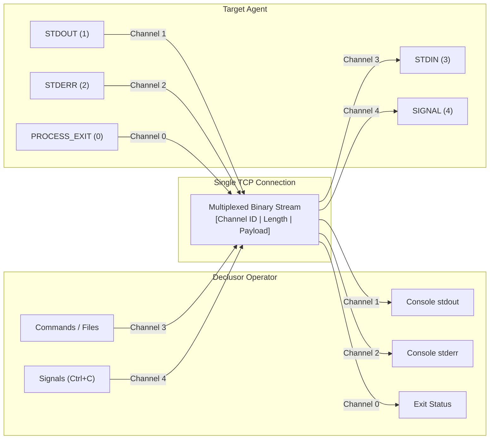

# Multiplexed Channel Types

**Channel Types** are logical communication lanes that allow multiple distinct streams of data and control signals to travel simultaneously over a single TCP connection.

## The Problem It Solves

During a post-exploitation session, many different kinds of communication need to happen over the same network socket:

- Sending commands and files to the target.
- Receiving standard output (`stdout`).
- Receiving error messages (`stderr`) without mixing them into normal output or corrupting downloaded files.
- Knowing the exact exit code (`$?`) when a command finishes.
- Sending an interrupt signal (like pressing `Ctrl+C`) to stop a stuck command without killing the reverse shell itself.
- Checking whether an idle connection is still alive.

In a traditional reverse shell, all of these collide in a single unstructured stream.

## How It Works

When a plugin uses binary framing (`chunked_tlv`, such as `py_socket`), the single TCP connection acts like a **multi-lane highway (multiplexing)**. Every packet sent over the wire starts with a 1-byte **Channel ID** that tells the receiver which lane the data belongs to:

## Available Channels

| Channel ID | Name               |       Direction       | Purpose & Operational Benefit                                                                                                                                |
| :--------: | :----------------- | :-------------------: | :----------------------------------------------------------------------------------------------------------------------------------------------------------- |
|  **`0`**   | **`PROCESS_EXIT`** | Target $\to$ Operator | Signals that the remote command has finished running. The built-in protocol currently uses it as a completion marker and does not carry a process exit code. |
|  **`1`**   | **`STDOUT`**       | Target $\to$ Operator | Streams standard output chunks in real time as the remote process produces them.                                                                             |
|  **`2`**   | **`STDERR`**       | Target $\to$ Operator | Streams error messages on a dedicated lane, keeping errors visually distinct and preventing them from corrupting normal output.                              |
|  **`3`**   | **`STDIN`**        | Operator $\to$ Target | Carries commands, scripts, file uploads, in-memory modules, and interactive input from the operator to the target.                                           |
|  **`4`**   | **`SIGNAL`**       |    Bi-directional     | Reserved for future out-of-band control signals such as `SIGINT`; not currently implemented by the built-in agent.                                           |
|  **`5`**   | **`HEARTBEAT`**    |    Bi-directional     | Sends lightweight keep-alive probes to verify connection health and prevent firewalls or NAT gateways from dropping idle sessions.                           |
