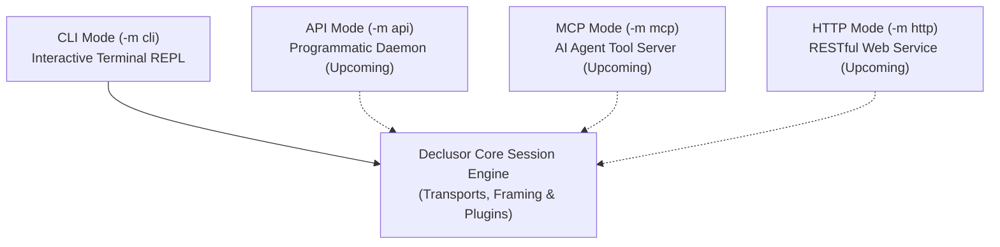

# Execution Modes

An **Execution Mode** defines the control interface through which an operator, script, or autonomous agent interacts with Declusor.

## The Problem It Solves

Most reverse-shell handlers are tightly coupled to a single human typing commands into a terminal. While great for manual engagements, this makes it difficult to automate post-exploitation tasks, integrate sessions into external security tools, or allow AI agents to operate a session programmatically.

Declusor separates its core session engine from the user interface, allowing the same underlying connection and plugins to be driven by different runtime modes.

## How It Works

When Declusor starts, the selected execution mode (`-m` / `--mode`) determines which interface sits on top of the active session:



## Available Modes

| Mode       | CLI Flag             |    Status     | Target Consumer    | Overview & Use Case                                                                                                                 |
| :--------- | :------------------- | :-----------: | :----------------- | :---------------------------------------------------------------------------------------------------------------------------------- |
| **`cli`**  | `-m cli` _(Default)_ | **Available** | Human Operators    | Interactive terminal prompt with command history (`Up`/`Down`), smart tab-completion, and real-time output streaming.               |
| **`api`**  | `-m api`             | **Upcoming**  | Scripts & Tooling  | Headless daemon mode designed for programmatic control, automated pipelines, and third-party orchestration.                         |
| **`mcp`**  | `-m mcp`             | **Upcoming**  | AI Agents & LLMs   | Model Context Protocol server exposing remote command execution, file transfers, and modules as native tools for autonomous agents. |
| **`http`** | `-m http`            | **Upcoming**  | Web UIs & Webhooks | RESTful HTTP interface for browser-based dashboards, remote webhooks, and multi-operator collaboration.                             |

## Usage Examples

```bash
# Start in the default interactive CLI mode
declusor 127.0.0.1 4444

# Explicitly select the CLI execution mode
declusor 127.0.0.1 4444 -m cli
```
