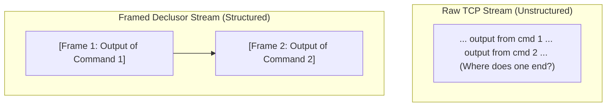

# Stream Framing Modes

A **Framing Mode** defines how Declusor marks the beginning and end of every command and response over a raw network connection.

## The Problem It Solves

TCP is a continuous stream of raw bytes—it has no built-in concept of "messages." In a standard `netcat` reverse shell:

- You never know for sure when a command has finished running (especially if it produces no output, like `cp` or `chmod`).
- If you run multiple commands quickly, their outputs blend together.
- Sending or receiving binary files over the same connection easily corrupts the terminal or hangs the session.

**Stream Framing** solves this by wrapping every command transaction in deterministic boundaries so the operator and the target always stay 100% synchronized.

## Framing Strategies

Different target environments have different capabilities. A bare Linux `/bin/sh` shell works with text, while a full runtime like Python can manipulate binary headers natively.

### `ephemeral_envelope` _(Dynamic Per-Command Token)_

Used by native shell clients (such as `shell_socket`). Before sending a command, Declusor generates a fresh, random 128-bit hexadecimal token (nonce). The target runs the command, streams the output in real time, and prints a unique closing tag containing that exact token (`__DECLUSOR_EOF_<token>__`) when finished.

- **Pros**:
  - **Zero External Dependencies**: Works using only built-in POSIX/Bash commands (`read`, `printf`, `eval`)—no Python, Perl, or external binaries needed on the target.
  - **Near-Zero Collision Risk**: Because a new 128-bit random token is generated for every single command, the chance of command output accidentally matching the closing tag is practically zero ($\le 2^{-128}$).
  - **No Hardcoded Secrets**: No static delimiters are stored in the launcher script.
  - **Fault Tolerant**: Even if a command fails or has a syntax error, the closing tag is still sent cleanly, preventing the session from hanging.
- **Cons**:
  - **Delimiter Scanning**: Declusor must watch the incoming stream for the closing tag, requiring a tiny lookahead buffer before printing the very last bytes.
  - **Single Stream**: Combines standard output and error output into one stream, and outgoing command text cannot contain raw null bytes (`\x00`).

### `chunked_tlv` _(Binary Type-Length-Value)_

Used by binary-capable runtimes (such as `py_socket`). Every chunk of data sent over the wire is prefixed with a compact 5-byte binary header: **1 byte for the Channel Type** + **4 bytes for the exact Payload Length**, followed by the payload bytes.

- **Pros**:
  - **100% Binary Safe**: Can transmit any raw data (compiled binaries, images, null bytes) without text encoding overhead and with **zero possibility of delimiter collision**.
  - **Zero Buffering Latency**: Because the exact byte length is declared upfront in the header, Declusor reads the exact number of bytes and processes them immediately without scanning the content.
  - **Channel Multiplexing**: Allows multiple independent channels (`stdout`, `stderr`, exit codes, and `Ctrl+C` signals) to travel simultaneously over the same socket.
- **Cons**:
  - **Runtime Requirement**: Requires an interpreter or binary on the target capable of reading and writing exact byte counts (e.g., Python)—cannot be done cleanly in a bare `/bin/sh` shell without external tools.

### `sentinel` _(Static Fixed Marker)_

A classic framing approach that uses a fixed, predetermined byte sequence (such as a newline `\n` or a static word like `END_OF_COMMAND`) to mark the end of a message.

- **Pros**:
  - **Simplicity**: Very easy to understand and implement in minimal one-off scripts.
  - **Zero Header Overhead**: Does not generate dynamic tokens or binary length prefixes.
- **Cons**:
  - **High Collision Risk**: If the output of a command naturally contains the static marker (for example, printing a log file or source code that contains the marker word), the stream cuts off early and **permanently desynchronizes the session**.
  - **Easy to Fingerprint**: Fixed markers on the wire are trivial for network monitors to detect.

### `cobs` _(Consistent Overhead Byte Stuffing)_

Transforms arbitrary binary payloads so that a specific reserved byte (typically the null byte `\x00`) is completely eliminated from the data by replacing every `\x00` with a jump offset to the next `\x00`. On the wire, `\x00` is then appended at the end as an unambiguous frame boundary.

- **Pros**:
  - **100% Binary Safe with Zero Collisions**: Even if the original file or output contains thousands of null bytes, they are preserved losslessly without ever triggering a premature frame cut.
  - **Minimal Bounded Overhead**: Adds at most 1 byte per 254 bytes of data ($< 0.4\%$ overhead), compared to $+33\%$ for Base64 or $+100\%$ for Hex.
  - **Boundary Recovery**: COBS preserves unambiguous frame boundaries, but does not detect or repair corrupted payloads. Pair it with HMAC or an AEAD layer when wire tampering must be detected.
- **Cons**:
  - **Block Encoding Pass**: Requires scanning up to 254 bytes ahead before emitting each block pointer.

### `http_chunked` _(HTTP/1.1 Chunked Transfer Encoding)_

Formats every output piece identically to standard HTTP chunked responses: `<hex-length>\r\n<payload>\r\n`, terminated by a zero-length chunk (`0\r\n\r\n`).

- **Pros**:
  - **Traffic Camouflage**: Blends naturally into standard HTTP/1.1 response streams inspected by web proxies and firewalls.
  - **Human & Text Readable**: Length headers are plain ASCII hexadecimal digits.
- **Cons**:
  - **Formatting Overhead**: Adds multiple `\r\n` sequences and ASCII hex characters per chunk.

### `netstrings` _(Length-Prefixed Text Frames)_

Wraps every message in Dan Bernstein's self-delimiting text format: `<decimal-length>:<payload>,` (for example, `5:hello,`).

- **Pros**:
  - **Trivial to Parse**: Can be implemented in a few lines of almost any scripting language without binary struct-packing libraries.
  - **Self-Validating**: The trailing comma acts as an immediate sanity check that the declared length matched the payload.
- **Cons**:
  - **Text-Length Parsing**: Requires reading digits until the colon (`:`) and converting from ASCII decimal before reading the payload.

### `varint_length` _(Variable-Length Integer Prefix)_

Prefixes each frame with its byte length encoded as a base-128 variable-length integer (LEB128/Varint), where lengths under 128 bytes occupy just a single byte.

- **Pros**:
  - **Maximum Bandwidth Efficiency**: Ideal for low-bandwidth or covert channels (such as DNS or ICMP) where saving 3 header bytes on short interactive commands matters.
- **Cons**:
  - **Bitwise Unpacking**: Requires bit-shifting loop logic on both endpoints to decode the length prefix.

### Summary Comparison

| Property                    |    `ephemeral_envelope`    |        `chunked_tlv`         | `sentinel` |           `cobs`            | `http_chunked`  |  `netstrings`   | `varint_length` |
| :-------------------------- | :------------------------: | :--------------------------: | :--------: | :-------------------------: | :-------------: | :-------------: | :-------------: |
| **Target Requirement**      | Pure Shell (`bash` / `sh`) | Binary Runtime (e.g. Python) |    Any     |        Byte Runtime         |   Text / HTTP   |       Any       |  Byte Runtime   |
| **Used By Built-in Plugin** |       `shell_socket`       |         `py_socket`          |     —      |              —              |        —        |        —        |        —        |
| **Collision Risk**          |   Near Zero ($2^{-128}$)   |        **Zero ($0$)**        |    High    |       **Zero ($0$)**        | **Zero ($0$)**  | **Zero ($0$)**  | **Zero ($0$)**  |
| **Raw Binary Safety**       |   Text / Encoded Binary    |    **100% Native Binary**    |    Low     |      **100% Encoded**       | **100% Native** | **100% Native** | **100% Native** |
| **Channel Multiplexing**    |             No             |           **Yes**            |     No     |             No              |       No        |       No        |       No        |
| **Streaming Latency**       |     Minimal (Tag Scan)     |   **Zero (Exact Length)**    |  Minimal   | Minimal ($\le 254\text{B}$) |    **Zero**     |    **Zero**     |    **Zero**     |

## Available Framing Modes

| Mode                     | Framing ID           |    Status     | Target Runtime                | Purpose                                                                                  |
| :----------------------- | :------------------- | :-----------: | :---------------------------- | :--------------------------------------------------------------------------------------- |
| **`ephemeral_envelope`** | `ephemeral_envelope` | **Available** | Pure Shell (`shell_socket`)   | Delimits transactions via dynamic 128-bit nonces for zero-dependency shell environments. |
| **`chunked_tlv`**        | `chunked_tlv`        | **Available** | Binary Runtimes (`py_socket`) | Binary 5-byte Type-Length-Value frames with multiplexing and zero buffering latency.     |
| **`sentinel`**           | `sentinel`           | _Extensible_  | Generic / Custom              | Static marker or fixed delimiter byte sequences.                                         |
| **`cobs`**               | `cobs`               | _Extensible_  | Byte Streams / Low-Level      | Eliminates null bytes with $< 0.4\%$ overhead for unambiguous `\x00` frame delimitation. |
| **`http_chunked`**       | `http_chunked`       | _Extensible_  | Web Proxies / HTTP            | HTTP/1.1 `Transfer-Encoding: chunked` framing for web traffic blending.                  |
| **`netstrings`**         | `netstrings`         | _Extensible_  | Lightweight Interpreters      | Simple `<length>:<payload>,` framing parseable without binary struct libraries.          |
| **`varint_length`**      | `varint_length`      | _Extensible_  | Low-Bandwidth Channels        | Compact LEB128 variable-length integer prefix (1 byte for payloads $< 128$ bytes).       |
