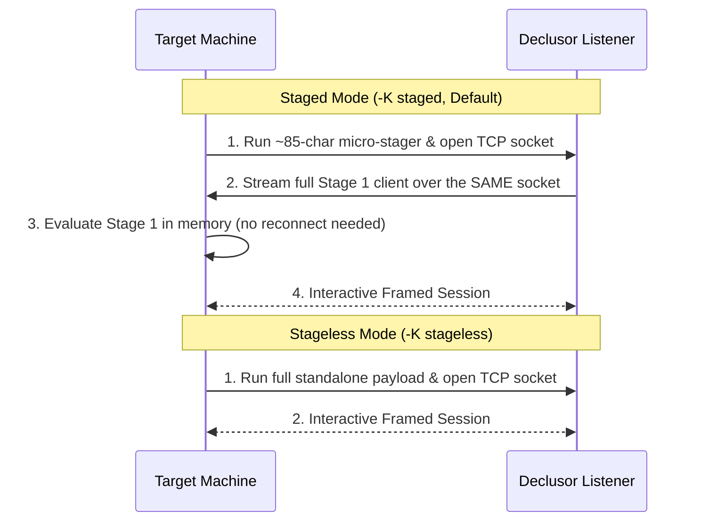

# Launcher Delivery

**Launcher Delivery** controls how Declusor generates, formats, and hands off the initial reverse-shell command (the _launcher_) to be executed on the target machine.

## The Problem It Solves

Getting an initial payload onto a target during an assessment often runs into practical obstacles:

- **Strict Length Limits**: Web command injections, HTTP headers, or vulnerable parameters often truncate long commands.
- **Terminal Clutter**: Printing giant multi-kilobyte payloads floods your terminal and makes copying error-prone.
- **Shell Escaping**: Different target contexts require different invocation wrappers (e.g., `bash -c`, `python3 -c`, or `sudo`).

Declusor solves this by dividing launcher delivery into three independent choices: **Kind**, **Output Mode**, and **Wrapper**.

## Launcher Kind (`-K` / `--launcher-kind`)

The launcher kind determines whether the initial command is a tiny bootstrap loader or a full standalone script.



| Kind            | CLI Flag                |    Status     |   Footprint    | Connection Model                                   | Best Used When...                                                                                    |
| :-------------- | :---------------------- | :-----------: | :------------: | :------------------------------------------------- | :--------------------------------------------------------------------------------------------------- |
| **`staged`**    | `-K staged` _(Default)_ | **Available** | ~85–135 bytes  | Single-socket (pulls Stage 1 over same connection) | Web command injections with strict buffer limits or URL parameter length restrictions.               |
| **`stageless`** | `-K stageless`          | **Available** | Multi-kilobyte | Standalone (monolithic client payload)             | Saving payload as a standalone script file on disk or in environments prohibiting 2nd-stage staging. |

### `staged` _(Default — Single-Socket Micro-Stager)_

Generates an ultra-compact Stage 0 loader (~85 characters in Bash, ~135 characters in Python). When executed, it connects back to Declusor, pulls the full client into memory over **that exact same TCP connection**, and starts the session without ever dropping the socket.

- **Pros**:
  - **Tiny Footprint**: Easily fits inside size-restricted injection vectors, URLs, and tight buffers.
  - **Minimal Log Noise**: Leaves almost no code visible in process listings (`ps`) or web server logs.
  - **Single Connection**: Reuses the initial socket rather than opening a second connection that a firewall might block.
- **Cons**:
  - Requires the initial socket stream to receive the Stage 1 bootstrap payload immediately upon connection.

### `stageless` _(Monolithic Standalone Payload)_

Embeds the entire client logic directly into a single self-contained command.

- **Pros**:
  - **Self-Contained**: Contains all logic upfront without needing a Stage 1 download step.
  - **Standalone**: Ideal when saving the launcher as a script file on disk or in air-gapped script testing.
- **Cons**:
  - **Large Size**: Produces a command string of several kilobytes, which may be rejected by length-limited vulnerabilities.

## Output Mode (`-O` / `--launcher-output`)

Controls where Declusor sends the generated launcher when starting up:

| Mode            | CLI Flag                  | Behavior                                                                                                                                    | Best Used When...                                                                     |
| :-------------- | :------------------------ | :------------------------------------------------------------------------------------------------------------------------------------------ | :------------------------------------------------------------------------------------ |
| **`terminal`**  | `-O terminal` _(Default)_ | Prints the launcher command directly to the terminal screen.                                                                                | You want to visually inspect the one-liner or copy it manually.                       |
| **`clipboard`** | `-O clipboard`            | Copies the launcher directly to your system clipboard (using terminal OSC 52 sequences and OS clipboard tools) with **zero screen output**. | You want a clean terminal and immediate `Ctrl+V` pasting into an exploit or browser.  |
| **`silent`**    | `-O silent`               | Suppresses all launcher output.                                                                                                             | Running automated scripts or waiting for a callback from an already-deployed payload. |
| **`file`**      | `-O file:<path>`          | Writes the launcher payload directly to a local file.                                                                                       | Hosting the payload on a web server or embedding it into an exploit script.           |

## Shell Wrapper (`-W` / `--launcher-wrapper`)

By default, each plugin wraps its launcher in a sensible command for its runtime (such as `bash -c '...'` or `python3 -c '...'`). You can override how the command is invoked on the target using `-W` and the `$DECLUSOR_SCRIPT` placeholder:

```bash
# Wrap the payload inside a custom command execution template
declusor 127.0.0.1 4444 -p py_socket -W "/usr/local/bin/python3 -c '$DECLUSOR_SCRIPT'"
```

## Usage Examples

```bash
# Default: Generate a compact staged launcher and print to terminal
declusor 127.0.0.1 4444

# Copy a compact staged launcher straight to the clipboard (nothing printed to screen)
declusor 127.0.0.1 4444 -O clipboard

# Generate a full stageless payload and save it to a file
declusor 127.0.0.1 4444 -K stageless -O file:/tmp/payload.sh
```
