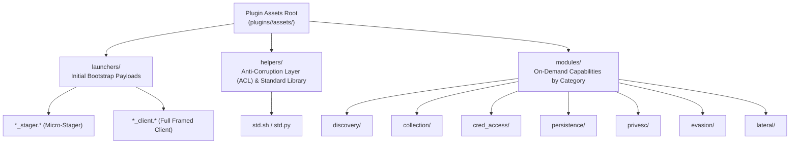
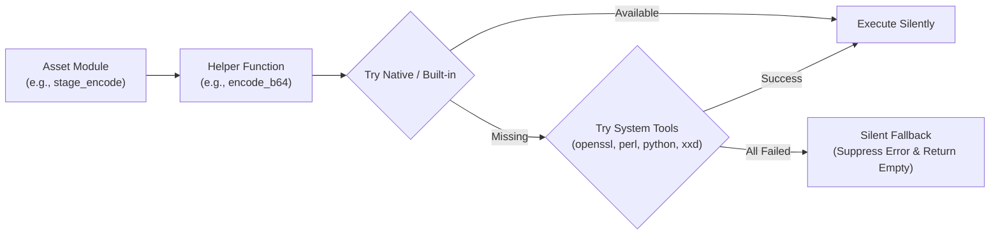

# Plugin Assets

**Plugin Assets** are target-side scripts, bootstrap stagers, runtime libraries, and operational modules bundled with each Declusor client plugin.

## The Problem It Solves

Traditional reverse shells treat remote targets as blunt interactive terminals, requiring operators to manually paste snippets, copy files individually, or deal with missing tools and differing runtime versions across target systems:

- **Lack of Portability**: Commands often assume specific binaries (like `curl`, `wget`, or `python3`) are installed, failing abruptly when a target uses minimal base images or restricted shells.
- **Operator Noise & Leakage**: Unchecked command failures and syntax errors spray stderr back into operator terminals and system log files on the target.
- **Monolithic Inflexibility**: Packing all capabilities into the initial reverse shell makes payloads huge, noisy, and difficult to deliver through size-constrained vectors.

Declusor solves this by organizing target-side payloads into a structured asset hierarchy (`launchers/`, `helpers/`, and `modules/`) managed by each plugin's `IPluginProcessor` and `PluginFilesystem`.

## Asset Directory Layout

Each plugin declares an `assets/` directory adhering to the standard structure:



| Asset Tier    | Directory    | Execution Timing                     | Purpose & Responsibilities                                                                                             |
| :------------ | :----------- | :----------------------------------- | :--------------------------------------------------------------------------------------------------------------------- |
| **Launchers** | `launchers/` | Initial connection bootstrap         | Stage 0 micro-stagers (`*_stager.*`) and standalone framed clients (`*_client.*`) delivered via `--launcher-kind`.     |
| **Helpers**   | `helpers/`   | Client initialization                | Target standard library (`std.sh`, `std.py`) loaded once at session startup, acting as an Anti-Corruption Layer (ACL). |
| **Modules**   | `modules/`   | On-demand (`load <category/module>`) | Domain-specific reconnaissance and task scripts executed in memory via the session runner.                             |

## Asset Components & Architecture

### 1. Launchers (`launchers/`)

Launchers are the entry points to establishing a Declusor session on the target:

- **Stagers (`*_stager.*`)**: Ultra-compact bootstrap loaders (~85–135 bytes). When executed on the target, the stager connects back over TCP, downloads the full client script from Declusor over the exact same socket, and executes it in memory without spawning secondary network connections.
- **Clients (`*_client.*`)**: Complete protocol clients implementing framing (e.g., Netstring length-prefixing or raw streams), heartbeat handling, and command evaluation. In staged delivery, the client is streamed automatically by Declusor upon connection; in stageless delivery, it is directly embedded in the initial launcher.

### 2. Helpers (`helpers/`)

The helper library serves as an in-memory **Anti-Corruption Layer (ACL)** on the target machine. Instead of relying on a single hardcoded system binary, helper functions abstract common operations across multi-tool fallback chains:



Key ACL abstractions implemented across `helpers/` files:

- **Encoding & Hashing**: `encode_b64`, `decode_b64`, `hash_value`.
- **Compression & Archiving**: `compress_gzip`, `decompress_gzip`, `archive_dir`, `extract_archive`.
- **HTTP / Remote Retrieval**: `fetch_url`.
- **Process & Socket Inspection**: `list_processes`, `list_sockets` .
- **Silent Error Suppression**: All helper primitives route `stderr` to `/dev/null` so that internal probing failures never pollute the operator's terminal or generate telemetry noise on the target.

### 3. Modules (`modules/`)

Modules are domain-specific scripts organized into capability directories (`discovery/`, `collection/`, `cred_access/`, `persistence/`, `privesc/`, `evasion/`, `lateral/`).

- **Header Standardization**: Every module should begin with a standardized, generic capability header (avoiding rigid tool-specific naming):
  ```bash
  # ---
  # Module: System Environment & Runtime Reconnaissance
  # Description: Gathers hardware, kernel, distribution, and container indicators.
  # ---
  ```
- **Helper Integration**: Modules invoke `helpers/` primitives rather than raw shell pipelines. For example, modules use `label "Section"` and `format_perms` to render structured output consistently across targets.
- **On-Demand Loading**: In interactive sessions, operators load modules using the built-in `load` command:
  ```bash
  [declusor] load discovery/system_info
  [declusor] load collection/stage_encode
  ```

## Discovery and Path Resolution

Declusor resolves plugin assets at runtime through `declusor.contract.PluginFilesystem`:

```python
plugin_fs = PluginFilesystem.from_root(plugin_dir)

# Access typed asset subdirectories
launchers_dir = plugin_fs.launchers  # -> assets/launchers
helpers_dir   = plugin_fs.helpers    # -> assets/helpers
modules_dir   = plugin_fs.modules    # -> assets/modules
```

When running in CLI mode, the interactive REPL automatically binds tab completion to the active plugin's `assets/modules/` directory:

- Typing `load <TAB>` presents the available categories and module scripts.
- The path resolver automatically suppresses internal development artifacts (`__pycache__`, `.git`, `.venv`, `.pyc`).

## Customizing Assets (`--assets-dir`)

Operators can override the active plugin's built-in asset directory using the `--assets-dir` CLI option:

```bash
# Start listener with a custom assets tree
declusor 127.0.0.1 4444 -p shell_socket --assets-dir /opt/custom-assets
```

When `--assets-dir` is provided, Declusor replaces the plugin's default asset root, allowing operators to deploy tailored helper libraries or proprietary module sets without modifying the core repository.

## Asset Verification and Quality Control

All plugin assets undergo automated linting and syntax validation as part of the project test lifecycle:

```bash
# Validate scripts across all plugin assets
make check TARGET=plugin-assets

# Check asset formatting and types
make check TARGET=plugins
```

- **Shell Assets (`shell_socket`)**: Validated against `shellcheck` with project-level `.shellcheckrc` configuration enforcing portable syntax and POSIX safety.
- **Python Assets (`py_socket`)**: Validated against `ruff` and `mypy` using isolated configuration targets in `plugins/py_socket/pyproject.toml`.
