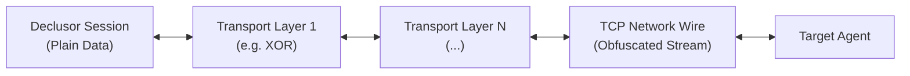

# Transport Layers

A **Transport Layer** wraps the raw network connection in a transformation pipeline that may obfuscate, authenticate, or encrypt traffic before it crosses the network.

Every selected layer must be implemented on both endpoints with compatible
configuration. A server-side layer alone does not secure or preserve the
session protocol.

## The Problem It Solves

Traditional reverse shells transmit commands and outputs in plain text over TCP. Network Intrusion Detection Systems (NIDS), firewalls, and deep packet inspection (DPI) appliances can easily spot common shell strings (like `/bin/sh`, `uid=`, or `whoami`), flag the traffic, and terminate the connection.

Transport layers solve this by decoupling the session protocol from how bytes look on the wire.

## How It Works

Transport layers work like **layers of an onion**:

1. **Outgoing Traffic**: When the session sends a command or file, the data passes sequentially through each configured layer before reaching the network socket.
2. **Incoming Traffic**: When bytes arrive from the network, they are unwrapped in the reverse order before being handed back to the session.
3. **Session Transparency**: Client plugins and commands do not need to know which transport layers are active—they simply read and write normal data.



### Immunity to Network Fragmentation

Over a real network, TCP frequently splits large messages into smaller packets or merges small writes together. Naive encryption wrappers often break when a packet is cut in the middle.

Declusor's transport layers maintain continuous, independent stream cursors for incoming and outgoing bytes. No matter how the network fragments or groups packets in transit, the stream stays synchronized from start to finish.

## Transport Layer Strategies

Different operational scenarios demand different trade-offs between speed, bootstrap size, and cryptographic strength.

### `xor` _(Symmetric Repeating-Key Stream)_

Applies a byte-by-byte XOR transformation against a repeating keystream, tracking read and write offsets independently so arbitrary TCP packet fragmentation never desynchronizes the stream.

- **Pros**:
  - **Zero External Dependencies**: Can be implemented in pure shell or minimal runtimes without cryptographic libraries.
  - **Ultra-Fast & Lightweight**: Adds negligible CPU overhead and minimal bytes to the client stager.
  - **Signature Evasion**: Immediately defeats basic cleartext NIDS rules and static string matching.
- **Cons**:
  - **Obfuscation Only**: Does not provide cryptographic security against dedicated traffic analysis or known-plaintext recovery.

### `tls13` _(Transport Layer Security 1.3)_

Wraps the raw socket in a standard TLS 1.3 tunnel, providing industry-standard asymmetric key exchange, authenticated encryption, and optional certificate verification.

- **Pros**:
  - **Full Cryptographic Security**: Guarantees confidentiality, message integrity, and endpoint authentication.
  - **Protocol Blending**: Network traffic looks identical to standard HTTPS communication over the wire.
- **Cons**:
  - **Higher Bootstrap Overhead**: Requires TLS library support on the target and certificate/key provisioning.

### `noise_psk` _(Noise Protocol Framework with PSK)_

Establishes an encrypted, mutually authenticated channel using the Noise Protocol Framework with a pre-shared symmetric key (PSK) instead of traditional X.509 certificates.

- **Pros**:
  - **Zero PKI Complexity**: Eliminates certificate generation and validation while providing strong mutual authentication and forward secrecy.
  - **Compact Handshake**: Much lighter and faster to negotiate than a full TLS handshake.
- **Cons**:
  - **Key Distribution**: Requires the pre-shared key to be embedded or present on both endpoints before connecting.

### `hmac` _(Keyed-Hash Message Authentication)_

Attaches a cryptographic message authentication code (such as HMAC-SHA256) to transmitted data without encrypting the payload itself.

- **Pros**:
  - **Tamper Resistance**: Immediately detects packet modification, replay, or unauthorized command injection on the wire.
  - **Minimal CPU Cost**: Avoids full stream encryption overhead when confidentiality is not required.
- **Cons**:
  - **No Confidentiality**: Commands and outputs remain readable in plain text to passive network observers.

### `chacha20_poly1305` _(Authenticated Stream Cipher)_

Encrypts and authenticates the stream using the ChaCha20 stream cipher paired with the Poly1305 message authenticator (AEAD).

- **Pros**:
  - **High Software Performance**: Runs extremely fast on CPUs that lack dedicated AES hardware acceleration (such as ARM, MIPS, and IoT/embedded targets).
  - **Built-in Integrity**: Combines encryption and tamper detection in a single pass.
- **Cons**:
  - **Strict Nonce Management**: Requires unique per-record nonces to guarantee keystream safety.

### `zlib` _(Real-Time Stream Compression)_

Compresses outgoing and incoming byte streams on the fly using Deflate/Zlib before passing them to underlying encryption or network layers.

- **Pros**:
  - **Bandwidth Efficiency**: Dramatically speeds up large text outputs, log dumps, and file transfers over slow or throttled links.
- **Cons**:
  - **Compression Oracle Risk**: Should be carefully paired when compressing predictable secrets alongside attacker-controlled inputs.

### `websocket` _(RFC 6455 Frame Encapsulation)_

Encapsulates the raw transport stream inside standard WebSocket binary frames preceded by an HTTP Upgrade handshake.

- **Pros**:
  - **Proxy & Firewall Traversal**: Traverses corporate HTTP proxies, CDNs, and Layer-7 firewalls that block non-HTTP protocols.
- **Cons**:
  - **Framing Overhead**: Adds an initial HTTP handshake and a small per-frame header cost.

## Available Layers

Operators can enable one or more transport layers at startup using the `-L` / `--transport-layer` flag:

| Layer                   | CLI Flag       |      Status      | Description                                                                               |
| :---------------------- | :------------- | :--------------: | :---------------------------------------------------------------------------------------- |
| **`xor`**               | `-L xor`       |  **Available**   | Repeating-key symmetric XOR stream obfuscation.                                           |
| **`hmac`**              | `-L hmac`      | **Programmatic** | Keyed-hash message integrity and authentication without confidentiality.                  |
| **`tls13`**             | `-L tls13`     |   **Upcoming**   | TLS 1.3 standard confidentiality, integrity, and authentication.                          |
| **`noise_psk`**         | `-L noise_psk` |   **Upcoming**   | Mutual authentication and secure channel using Noise Protocol with pre-shared keys (PSK). |
| **`chacha20_poly1305`** | `-L chacha20`  |   _Extensible_   | High-speed authenticated stream cipher (AEAD) ideal for embedded and non-AES-NI targets.  |
| **`zlib`**              | `-L zlib`      |   _Extensible_   | Real-time stream compression to reduce bandwidth and speed up large transfers.            |
| **`websocket`**         | `-L ws`        |   _Extensible_   | RFC 6455 WebSocket encapsulation for traversing HTTP proxies and Layer-7 firewalls.       |

## Usage Examples

```bash
# Wrap the session in a symmetric XOR obfuscation layer
declusor 127.0.0.1 4444 -L xor

# Combine transport layers with any client plugin
declusor 127.0.0.1 4444 -p py_socket -L xor
```
